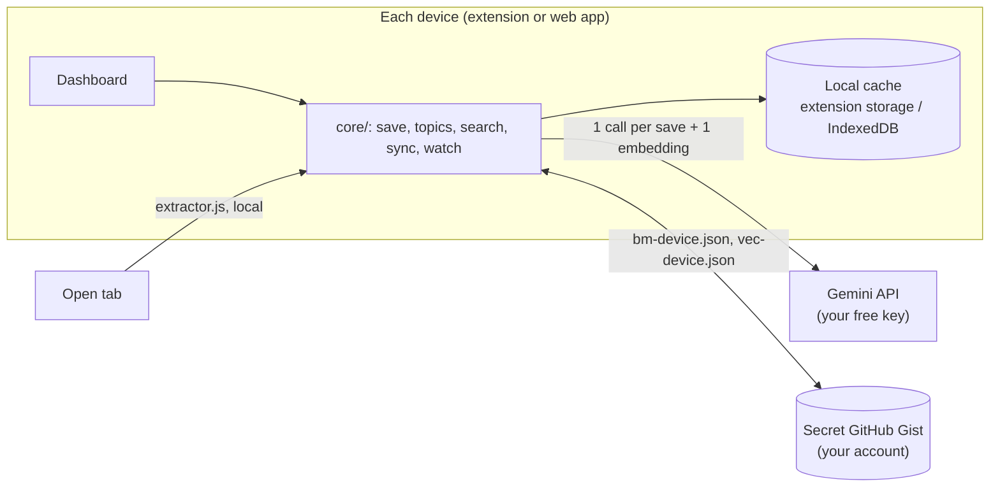

<div align="center">


# Stashwise

**Your stash, but smarter.**

Raindrop.io on steroids: one click saves a page, and AI writes the title and description, files it in the right topic, and answers questions about everything you've saved.

[](LICENSE)


[**Open the web app**](https://mayank-kushwaha.github.io/Stashwise/app/) · [**Download the extension**](https://mayank-kushwaha.github.io/Stashwise/stashwise.zip) · [Install guide](#install)

</div>

---

> Bookmarks you never have to organise. Save now, and ask later: *"what was that site with the PDF tools?"*

- **Save in one click.** Toolbar icon, `Alt+Shift+S`, or right-click any page or link.
- **Self-organising library.** Sections and topics appear as you save, and similar sites end up together.
- **Search by meaning**, not just keywords.
- **Ask AI** questions answered only from your own saved sites, with sources.
- **Follows sites that move.** Watched bookmarks update themselves when a site changes domain.
- **Every device, one library.** Chrome, Brave, Edge, Firefox and your phone, synced through a private GitHub Gist you own.
- **Free and private by design.** No server, no account, no tracking, no npm packages. You bring two free keys.

## Contents

- [Features](#features)
- [Install](#install)
- [Setup: the two free keys](#setup-the-two-free-keys)
- [Using it](#using-it)
- [How it works](#how-it-works)
- [Data model](#data-model)
- [Privacy and security](#privacy-and-security)
- [Limits](#limits)
- [Development](#development)
- [License](#license)

## Features

| Feature | What it does |
|---|---|
| **One-click save** | Reads the open tab locally (title, meta tags, headings, main text, preview image, icon) and saves it at once. The AI fills in the rest a moment later. |
| **AI titles and descriptions** | One Gemini call per save returns a clean title, a factual 1-2 sentence description, 3-6 tags, a section and a topic. |
| **Automatic topics** | Gemini sees your existing sections and topics and reuses one when it fits. A vector check stops it from filing a site into an unrelated topic. |
| **Re-organize** | Merges near-duplicate topics and moves clear outliers. It runs locally and uses no AI tokens. Preview first, then apply or undo. |
| **Search** | Instant keyword search as you type. Press Enter to also search by meaning (embeddings), with both rankings combined. |
| **Ask AI** | "Which site has PDF tools?" retrieves your 8 closest bookmarks and answers only from them, linking the sources. If nothing matches, it says so. |
| **Preview images** | Cards show the site's `og:image`, or its icon on a coloured placeholder. |
| **Pin** | Keeps a card at the top of its category. |
| **Address watch** | For sites that keep moving domains. A nightly check follows redirects and updates the address when the new site clearly matches, or asks you when it doesn't. |
| **Sync** | A private Gist in your GitHub account. Each device writes its own files, so two devices saving at the same time never overwrite each other. |
| **Web app (PWA)** | The same dashboard on any phone. Install it to the home screen, and on Android share links into it. |
| **Backup** | Export and import everything as JSON. |
| **Responsive UI** | Full-tab dashboard, dark and light themes, phone layout with a slide-out menu, keyboard shortcuts. |

## Install

### Chrome, Brave, Edge

1. Download [**stashwise.zip**](https://mayank-kushwaha.github.io/Stashwise/stashwise.zip) and extract it. Keep the folder; the browser runs the extension from it.
2. Open `chrome://extensions` (`brave://extensions`, `edge://extensions`).
3. Turn on **Developer mode**.
4. Click **Load unpacked** and pick the extracted folder (the one with `manifest.json`).
5. Pin the icon from the puzzle-piece menu. Settings opens on first run.

A warning that `background.scripts` requires manifest version 2 is expected. That key is there for Firefox, and Chromium ignores it.

**Updating:** extract the new zip into the same folder, then click reload on the extension card. The browser ties your settings to the folder's location.

### Firefox

Open `about:debugging#/runtime/this-firefox`, click **Load Temporary Add-on**, and pick `manifest.json`. Firefox removes temporary add-ons when it closes; a permanent install needs the add-on to be signed by Mozilla.

### Phone

Browsers on phones don't run extensions. Open the [web app](https://mayank-kushwaha.github.io/Stashwise/app/) and use **Add to Home screen** (iPhone: Safari → Share → Add to Home Screen). It reads and writes the same Gist.

The dashboard's **Get extension** button shows these steps too.

## Setup: the two free keys

Both keys stay on your device. Settings has a step-by-step guide for each, plus Test buttons that explain any problem.

| Key | Used for | How to get it |
|---|---|---|
| **GitHub token** (classic) | Syncing through a secret Gist | [Create one](https://github.com/settings/tokens/new?scopes=gist&description=Stashwise) with **only** the `gist` scope. Settings warns you if a token has wider access. |
| **Gemini API key** | Titles, topics, embeddings, Ask AI | [Google AI Studio → API keys](https://aistudio.google.com/apikey). The free tier needs no billing. |

On another device, paste the **same GitHub token**. Stashwise finds your existing Gist by itself.

## Using it

| Action | How |
|---|---|
| Save the current page | Toolbar icon, `Alt+Shift+S`, or right-click → *Save page to Stashwise* |
| Save a link | Right-click the link → *Save link to Stashwise*, or **Add** in the dashboard |
| Open the dashboard | `Alt+Shift+V`, or right-click the toolbar icon → *Open Stashwise* |
| Search | `/`, then type. `Enter` adds search by meaning |
| Ask AI | `A`, or the Ask AI tab |
| Save a URL | `N` |
| Shortcuts list | `?` |

The toolbar badge shows the save result: ✓ saved, `=` already saved, ✕ blocked or not a web page, `!` error.

**Preview images for older bookmarks:** click **Enable** on the dashboard notice, or Settings → Advanced → *Fetch previews*. The browser asks once for permission to read pages.

**Address watch:** click the radar icon on a card. The banner chip then shows *Watching*, *Address updated*, *New address found* or *Unreachable*; click it for details, history and **Check now**.

## How it works



### Saving

1. `extractor.js` runs in the tab and collects the URL (canonical if it's on the same host), title, meta description, `og:site_name`, preview image, icon, up to 12 `h1`/`h2` headings and up to 4,000 characters of the main text.
2. The URL is normalised for de-duplication: tracking parameters (`utm_*`, `fbclid`, `gclid`, …), the `#hash`, `www.` and a trailing slash are removed, and parameters are sorted. The bookmark ID is a SHA-256 of that URL. A site is also recognised under any address it had before.
3. The bookmark is stored immediately, marked *Waiting for AI*.
4. Gemini (`gemini-3.5-flash-lite` by default) gets a compact digest: title, site name, description (300 chars), 10 headings and 2,200 characters of text, plus the names of your existing topics (largest 40). It answers in a strict JSON schema, and the reply is validated before use.
5. One embedding (`gemini-embedding-2`, 768 dimensions) is made from the title, description and tags.
6. If Gemini is overloaded (HTTP 503) or a model is retired (404), the next model in the fallback chain is tried. Rate limits (429) are retried with backoff. Anything still pending is retried on every sync.

Links saved from the phone or by right-click have no open tab to read. For those, Gemini's URL-context tool fetches the page instead.

### Keeping topics clean

- **Wrong-topic guard:** if Gemini picks an existing topic with 2 or more members, but the page's vector is far from that topic's centre (cosine < 0.5), the page goes into Gemini's alternative new topic instead.
- **No duplicate topics:** a new topic whose page is very close to an existing topic's centre (cosine ≥ 0.8) is merged into that topic.
- **Re-organize** (⇄) applies the same rules to the whole library: it merges topics whose centres are ≥ 0.8 apart, and moves a bookmark out of a topic of 3+ when another topic fits better by 0.1 or more. You see every move before applying it, and you can undo.

### Search and Ask AI

- **Keyword search** runs locally on every keystroke. Every word must match somewhere; matches in title (×3), tags (×2), topic and section (×1.5), description (×1) and URL (×0.5) decide the order.
- **Search by meaning** (Enter) embeds the query and ranks the 30 nearest bookmarks, then merges both lists with reciprocal rank fusion.
- **Ask AI** embeds the question, takes the 8 nearest bookmarks and sends only their titles, descriptions and hosts to Gemini, with the instruction to answer from that list alone. The answer cites which ones it used.
- Vectors are stored as int8 with a scale factor (about 1 KB each at 768 dimensions), keeping over 99% cosine similarity to the originals in tests.

### Sync

- On first sync, Stashwise creates one **secret Gist** (description `AI Bookmark Vault data`, kept from the project's original name). If two devices race, the oldest Gist wins and the extra one is deleted.
- Each device has a random ID and writes only its own `bm-<device>.json` and `vec-<device>.json`. Readers merge all device files; for each bookmark the newest version wins. Deletions are kept as tombstones so they sync too.
- Requests use ETags, so an unchanged Gist costs a `304`. Files over 1 MB are read through `raw_url`.
- The extension syncs every 5 minutes in the background. The dashboard also syncs when opened, every 5 minutes while visible, and when you return to it.

### Address watch

For bookmarks you mark as watched, the extension runs one check per night at a random time between 1 and 5 am. If the browser was closed, the check runs within about 5 minutes of opening it.

| What the old address does | Result |
|---|---|
| Redirects (301/302) to a new domain | Followed |
| Has a `<meta http-equiv="refresh">` to a new domain | Followed |
| Has a script redirect to a URL containing the site's name | Followed (other script targets are treated as ads) |
| Names a new domain containing the site's name in its canonical link | Followed |
| Shows a bot-protection page, or loads only by script | Opened in a muted background tab (for up to about 30 seconds) to see where it lands |
| Redirects to a domain-parking or for-sale page | Never followed |
| Fails for 3 nights in a row | Marked *Unreachable* |

A new address is applied automatically only when its host contains the old site's name and the page title names the site (or shares 2 or more real words with the saved title). Otherwise it is shown as *New address found* for you to accept or reject. Rejected domains aren't suggested again. The last 5 addresses are kept with a **Restore** button, and the preview image is fetched again for the new address.

Each check is a single request with no cookies, reading at most 100 KB, with no AI involved.

## Data model

Bookmark record (`bm-<device>.json`):

| Field | Meaning |
|---|---|
| `id` | SHA-256 (first 9 bytes, hex) of the normalised URL at first save |
| `url` | Current address |
| `t`, `d`, `tags` | Title, description, tags |
| `sec`, `top` | Section and topic |
| `ts`, `u` | Created and last-updated times (ms). `u` decides merges |
| `pend` | 1 while waiting for AI |
| `pin` | Time pinned (0 = not pinned) |
| `img`, `ico` | Preview image and icon URLs (`img` missing = not looked up yet) |
| `del` | 1 = deleted (tombstone) |
| `w`, `hist`, `wv`, `wd`, `wch`, `wno` | Address watch: watched flag, previous addresses, change waiting for review, unreachable since, last automatic update, rejected domains |

Vector file (`vec-<device>.json`): `{ "m": "gemini-embedding-2:768", "v": { "<id>": [updatedAt, "scale:base64-int8"] } }`. Vectors from a different model are ignored, so changing the embedding model never mixes incompatible vectors.

## Privacy and security

- **Your data lives in your accounts only:** your browser, your Gist, your Gemini key. There is no Stashwise server.
- **What goes to Google:** the page digest described above, and your questions. Text requests are sent with `store: false`, so the Interactions API doesn't keep them as stored conversations. On the free tier, Google's terms say submitted data may be used to improve their products.
- **Never sent to AI:** `localhost` and private IP ranges, hosts starting with `mail.`, `accounts.`, `login.`, `signin.`, `auth.` or `secure.`, banking, PayPal and password-manager sites, incognito tabs, and any words you add under Settings → Advanced.
- **Secret Gists are unlisted, not private:** anyone who has the Gist's link can read it. Don't share the link.
- **Keys** are stored unencrypted in the browser's extension storage (IndexedDB in the web app). Use a GitHub token with only the `gist` scope.
- **Rendering:** all saved text is HTML-escaped. Only `http(s)` links are rendered, and images load with `referrerpolicy="no-referrer"`.
- **Supply chain:** zero runtime and zero dev dependencies. GitHub Actions are pinned to commit SHAs.

### Permissions

| Permission | Why |
|---|---|
| `activeTab`, `scripting` | Read the tab you are saving |
| `storage` | Local cache and settings |
| `alarms` | Background sync and the nightly address check |
| `contextMenus` | Right-click save |
| `api.github.com`, `gist.githubusercontent.com` | Gist sync |
| `generativelanguage.googleapis.com` | Gemini |
| *Optional:* all `http`/`https` sites | Only after you click Enable: preview images for older bookmarks and address watch |

## Limits

- **Gemini free tier** rate limits apply per project; see your [AI Studio dashboard](https://aistudio.google.com/rate-limit). Saves that hit a limit wait and retry.
- **Designed for a few thousand bookmarks.** Search and similarity run in the browser over all vectors.
- **The web app can't read other sites** (browsers block it), so it can't fetch preview images or run address checks. The desktop extension does both, and the results sync to the phone.
- **Address watch** can't find a new domain for a site that simply disappears without forwarding. Paste the new address in Edit.
- **Firefox** loads the extension as a temporary add-on only (see [Install](#install)).

## Development

No build step: the folder is the extension.

```
manifest.json      MV3 manifest (service worker on Chromium, event page on Firefox)
background.js      Toolbar, shortcuts, context menus, 5-minute sync alarm
extractor.js       Injected into the tab on save
app/               Dashboard and PWA (index.html, app.js, app.css, sw.js, manifest.webmanifest)
core/              ai.js · gist.js · store.js · merge.js · kv.js · save.js · topics.js
                   vec.js · search.js · images.js · watch.js · util.js
tests/             Offline tests (fake GitHub, Gemini and websites) + live API check
tools/             Icon generator (Node built-ins only)
```

```bash
npm test        # 23 offline tests (tested on Node 24; no install step, there are no dependencies)
npm run live    # real API check; put keys in dev.env.local.js first (git-ignored)
```

Copy `dev.env.local.example.js` to `dev.env.local.js` for the live check. Pushing to `main` deploys the web app and rebuilds `stashwise.zip` through `.github/workflows/pages.yml`.

## License

[MIT](LICENSE) © 2026 Mayank Kushwaha
